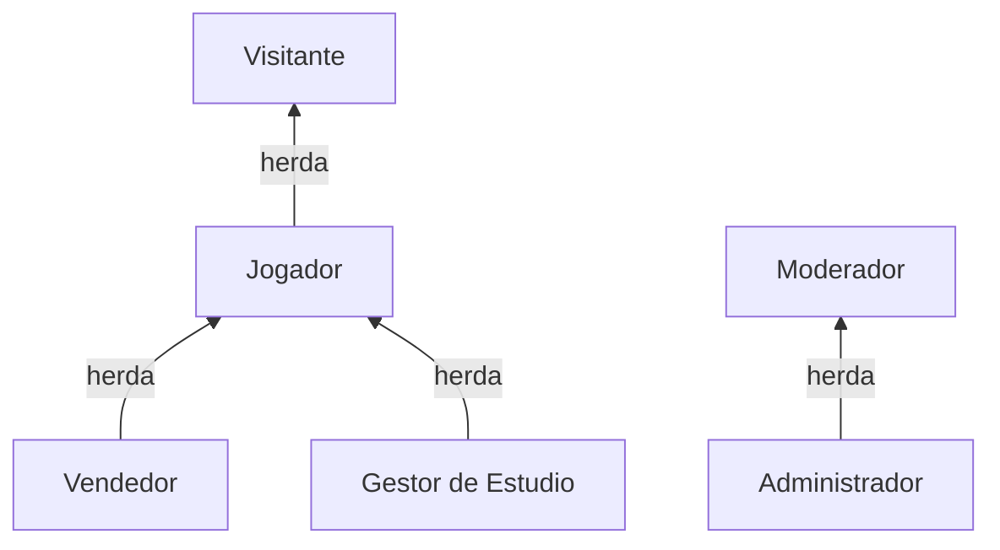
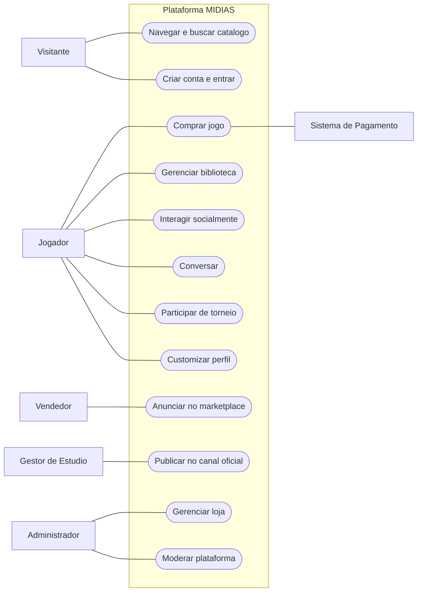
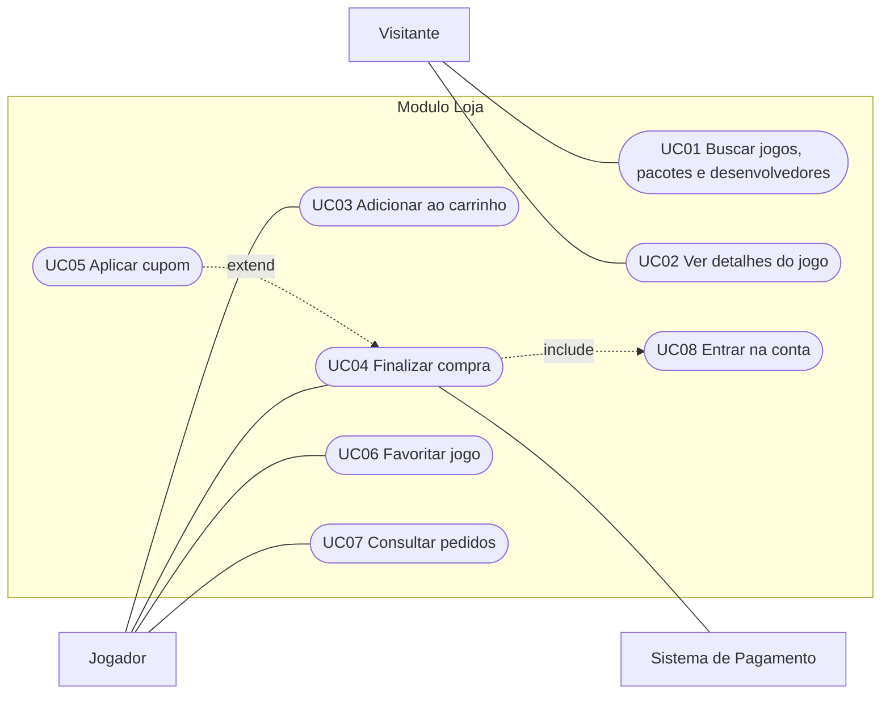
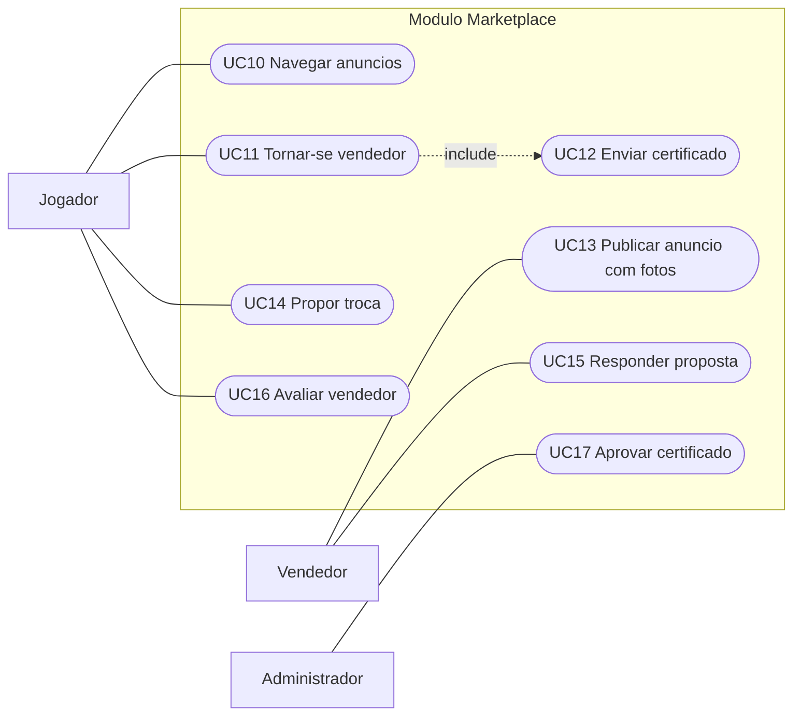
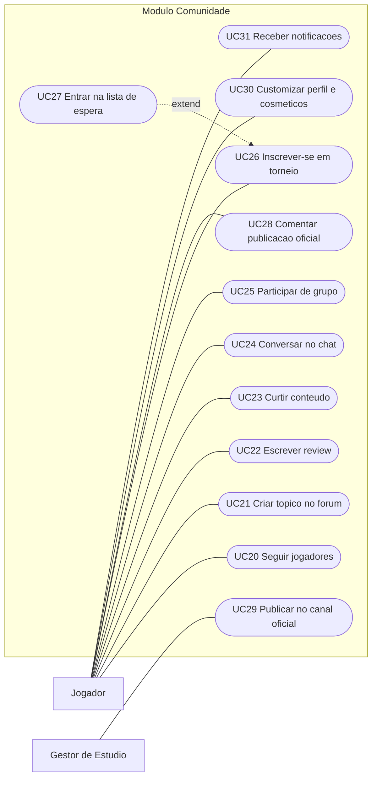
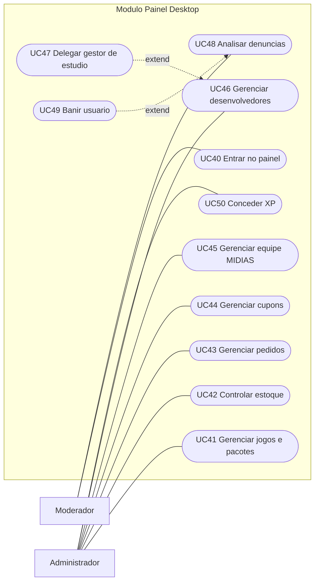

# Casos de Uso · Plataforma MIDIAS

> Documento de requisitos funcionais em notação UML (Casos de Uso), complementar ao [MER](./MER.md).
> Cobre as três plataformas que usam o mesmo banco: **Web**, **Mobile** e **Desktop (painel administrativo)**.

## 0. Convenções

| Elemento | Significado |
|---|---|
| **Ator** | Pessoa ou sistema externo que interage com a plataforma |
| `([Caso de uso])` | Funcionalidade que entrega valor ao ator |
| `include` | O caso sempre executa o outro (obrigatório) |
| `extend` | O caso pode executar o outro em uma condição (opcional) |
| **UCxx** | Identificador do caso de uso |
| **RNxx** | Regra de negócio aplicada |

---

## 1. Atores

| Ator | Descrição | Plataformas |
|---|---|---|
| **Visitante** | Pessoa sem login. Navega e pesquisa. | Web, Mobile |
| **Jogador** | Usuário com conta. Compra, joga, interage. Herda tudo do Visitante. | Web, Mobile |
| **Vendedor** | Jogador que anuncia jogos no marketplace entre pessoas. | Mobile, Web |
| **Gestor de Estúdio** | Jogador autorizado a publicar no canal oficial de um desenvolvedor. | Web |
| **Moderador** | Funcionário que analisa denúncias e conteúdo. | Desktop |
| **Administrador** | Gerencia toda a operação da loja. Herda tudo do Moderador. | Desktop |
| **Sistema de Pagamento** | Ator externo que confirma o pagamento. | — |
| **Serviço de Autenticação** | Ator externo (Supabase Auth) que valida login e sessão. | — |

---

## 2. Diagrama geral

---

## 3. Diagramas por módulo

### 3.1 Loja e compra (B2C)

### 3.2 Marketplace entre pessoas (C2C)

### 3.3 Comunidade, chat e torneios

### 3.4 Painel administrativo (Desktop)

---

## 4. Especificação dos casos de uso principais

### UC04 — Finalizar compra (com UC05 Aplicar cupom)

| Campo | Descrição |
|---|---|
| **Ator principal** | Jogador |
| **Ator secundário** | Sistema de Pagamento |
| **Plataforma** | Web e Mobile |
| **Pré-condições** | Jogador logado; carrinho com ao menos um jogo ou pacote com estoque. |
| **Pós-condições** | Pedido registrado; cupom contabilizado; jogos adicionados à biblioteca após pagamento. |

**Fluxo principal**
1. O Jogador abre o carrinho.
2. O sistema mostra itens, preço unitário e subtotal.
3. O Jogador clica em "Finalizar compra".
4. O sistema mostra a tela de pagamento.
5. O Jogador escolhe a forma de pagamento e confirma.
6. O sistema grava o pedido e os itens com o preço do momento.
7. O Sistema de Pagamento confirma.
8. O sistema adiciona os jogos à biblioteca e mostra a tela de compra concluída.

**Fluxo alternativo A1 — Aplicar cupom (UC05)**
- 4a. O Jogador digita um código de cupom.
- 4b. O sistema valida e mostra o desconto. Volta ao passo 5.

**Fluxos de exceção**
- E1. Cupom inválido, vencido ou esgotado: o sistema avisa e mantém o preço normal.
- E2. Jogo sem estoque: o sistema avisa e não permite concluir.
- E3. Pagamento recusado: o pedido fica pendente e o Jogador pode tentar de novo.

**Regras de negócio**
- RN01. Pedido e uso do cupom são gravados juntos, em uma única operação.
- RN02. O preço do pacote é o preço do pacote, não a soma dos jogos.
- RN03. O Jogador nunca altera o status do pedido.

---

### UC13 — Publicar anúncio no marketplace

| Campo | Descrição |
|---|---|
| **Ator principal** | Vendedor |
| **Plataforma** | Mobile (principal) e Web |
| **Pré-condições** | Jogador logado com perfil de vendedor ativo. |
| **Pós-condições** | Anúncio visível na lista do marketplace. |

**Fluxo principal**
1. O Vendedor toca em "Novo anúncio".
2. Informa jogo, plataformas, condição, preço e se aceita troca.
3. Envia até várias fotos.
4. Confirma a publicação.
5. O sistema salva o anúncio e o mostra na lista.

**Fluxos de exceção**
- E1. Campos obrigatórios vazios: o sistema destaca os campos.
- E2. Falha no envio de foto: o sistema avisa e permite reenviar.

---

### UC14 / UC15 — Propor e responder troca

| Campo | Descrição |
|---|---|
| **Atores** | Jogador (propõe) e Vendedor (responde) |
| **Pré-condições** | Anúncio ativo que aceita troca. |
| **Pós-condições** | Proposta aceita ou recusada; ambos notificados. |

**Fluxo principal**
1. O Jogador abre o anúncio e toca em "Propor troca".
2. Descreve o que oferece.
3. O sistema registra a proposta como aberta e notifica o Vendedor.
4. O Vendedor aceita ou recusa.
5. O sistema atualiza o status e notifica o Jogador.

**Exceções**
- E1. O Jogador tenta propor troca no próprio anúncio: o sistema bloqueia.
- E2. Usuário bloqueado: a proposta não é permitida.

---

### UC26 — Inscrever-se em torneio (com UC27 Lista de espera)

| Campo | Descrição |
|---|---|
| **Ator principal** | Jogador |
| **Plataforma** | Web e Mobile |
| **Pré-condições** | Jogador logado e não banido do torneio; inscrições abertas. |
| **Pós-condições** | Jogador inscrito ou na lista de espera. |

**Fluxo principal**
1. O Jogador abre o torneio.
2. O sistema mostra jogo, formato, datas e vagas restantes.
3. O Jogador toca em "Inscrever-se".
4. O sistema registra a inscrição e atualiza as vagas.

**Fluxo alternativo A1 — Torneio lotado (UC27)**
- 4a. Não há vagas: o sistema oferece a lista de espera.
- 4b. Se uma vaga abrir, o primeiro da fila é promovido e notificado.

**Exceções**
- E1. Jogador banido do torneio: inscrição negada.
- E2. Inscrições encerradas: botão indisponível.

---

### UC29 / UC28 — Publicar no canal oficial e comentar

| Campo | Descrição |
|---|---|
| **Atores** | Gestor de Estúdio (publica) e Jogador (comenta) |
| **Plataforma** | Web |
| **Pré-condições** | Gestor delegado pelo Administrador para aquele desenvolvedor. |
| **Pós-condições** | Publicação visível na página do desenvolvedor. |

**Fluxo principal**
1. O Gestor abre a página do desenvolvedor.
2. Escreve a novidade e anexa imagens.
3. O sistema publica no mural oficial.
4. Jogadores leem e comentam.
5. O Gestor pode editar, excluir ou remover comentários.

**Regras de negócio**
- RN04. Somente a conta oficial ou gestores publicam; os demais apenas comentam.
- RN05. Ser gestor não dá acesso ao painel desktop.

---

### UC30 — Customizar perfil e cosméticos

| Campo | Descrição |
|---|---|
| **Ator principal** | Jogador |
| **Plataforma** | Web e Mobile |
| **Pré-condições** | Jogador logado com ao menos um cosmético desbloqueado. |
| **Pós-condições** | Visual do perfil ou da página do jogo atualizado. |

**Fluxo principal**
1. O Jogador abre a customização (pelo perfil ou pelo botão ao lado das notificações).
2. O sistema mostra molduras, fundos, títulos e efeitos disponíveis.
3. O Jogador escolhe um item e vê a prévia.
4. Confirma.
5. O sistema salva e mostra "Cosmético atualizado".

**Exceções**
- E1. Item bloqueado: o sistema mostra como desbloquear.
- E2. Falha ao salvar: o sistema avisa e mantém o visual anterior.

---

### UC42 — Controlar estoque

| Campo | Descrição |
|---|---|
| **Ator principal** | Administrador |
| **Plataforma** | Desktop |
| **Pré-condições** | Logado no painel com papel de administrador. |
| **Pós-condições** | Estoque atualizado e movimentação registrada. |

**Fluxo principal**
1. O Administrador abre "Estoque".
2. O sistema lista jogos com quantidade e alerta de estoque baixo.
3. O Administrador registra entrada, saída ou ajuste, com motivo e fornecedor.
4. O sistema atualiza a quantidade e grava o histórico.

**Exceções**
- E1. Saída maior que o estoque: o sistema bloqueia.

---

### UC45 — Gerenciar equipe MIDIAS

| Campo | Descrição |
|---|---|
| **Ator principal** | Administrador |
| **Plataforma** | Desktop |
| **Pós-condições** | Página pública "Equipe" atualizada automaticamente. |

**Fluxo principal**
1. O Administrador abre "Equipe".
2. Cria ou edita um integrante: nome, cargo, bio, foto, capa e redes.
3. Reordena com "subir" e "descer".
4. Salva; o sistema confirma e a página pública reflete a mudança.

**Exceções**
- E1. Falha ao salvar: o sistema avisa e não perde os dados digitados.
- E2. Foto removida antes de salvar: o arquivo enviado é apagado.

---

### UC48 / UC49 — Analisar denúncia e banir

| Campo | Descrição |
|---|---|
| **Atores** | Moderador e Administrador |
| **Plataforma** | Desktop |
| **Pós-condições** | Denúncia resolvida e registrada no histórico. |

**Fluxo principal**
1. O Moderador abre "Denúncias".
2. Vê o conteúdo denunciado e o motivo.
3. Decide: arquivar, remover conteúdo ou banir (UC49).
4. O sistema grava a decisão no histórico de moderação.

**Fluxo alternativo — Banir (UC49)**
- 3a. Define prazo e motivo; o usuário fica impedido de interagir até a data.
- 3b. O usuário pode enviar recurso de banimento.

---

## 5. Matriz de rastreabilidade

| Caso de uso | Web | Mobile | Desktop | Entidades do MER |
|---|:-:|:-:|:-:|---|
| UC01 Buscar | ✓ | ✓ | ✓ | JOGO, BUNDLE, DESENVOLVEDOR |
| UC04 Comprar | ✓ | ✓ | | PEDIDO, ITEM DE PEDIDO, BIBLIOTECA |
| UC05 Cupom | ✓ | ✓ | | CUPOM, USO DE CUPOM |
| UC13 Anunciar | ✓ | ✓ | | ANÚNCIO, FOTO DE ANÚNCIO |
| UC14 Troca | | ✓ | | PROPOSTA DE TROCA |
| UC17 Certificado | | | ✓ | CERTIFICADO, PERFIL DE VENDEDOR |
| UC21 Fórum | ✓ | ✓ | | TÓPICO, RESPOSTA, CURTIDA |
| UC22 Review | ✓ | ✓ | | REVIEW COMPLETA |
| UC24 Chat | ✓ | ✓ | | CONVERSA, MENSAGEM |
| UC26 Torneio | ✓ | ✓ | | TORNEIO, PARTICIPANTE, LISTA DE ESPERA |
| UC29 Canal oficial | ✓ | | | PUBLICAÇÃO OFICIAL, GESTOR DE CANAL |
| UC30 Customizar | ✓ | ✓ | | COSMÉTICO, PERFIL |
| UC31 Notificações | ✓ | ✓ | | NOTIFICAÇÃO |
| UC42 Estoque | | | ✓ | MOVIMENTAÇÃO DE ESTOQUE, FORNECEDOR |
| UC45 Equipe | ✓ (leitura) | | ✓ | MEMBRO DA EQUIPE |
| UC46 Desenvolvedores | ✓ (leitura) | | ✓ | DESENVOLVEDOR |
| UC48 Denúncias | | | ✓ | DENÚNCIA, HISTÓRICO DE MODERAÇÃO |
| UC50 Conceder XP | | | ✓ | LOG DE XP, NÍVEL |

---

## 6. Requisitos não funcionais ligados aos casos de uso

| Código | Requisito |
|---|---|
| RNF01 | Web, Mobile e Desktop usam o mesmo banco: uma mudança no painel aparece no site. |
| RNF02 | Cada pessoa só lê e altera o que tem permissão (regras de acesso no banco). |
| RNF03 | Operações críticas (compra, cupom, XP, status de pedido) só por funções confiáveis. |
| RNF04 | Telas móveis funcionam por toque e cabem na tela do celular. |
| RNF05 | Visitantes veem catálogo e páginas públicas sem login. |
