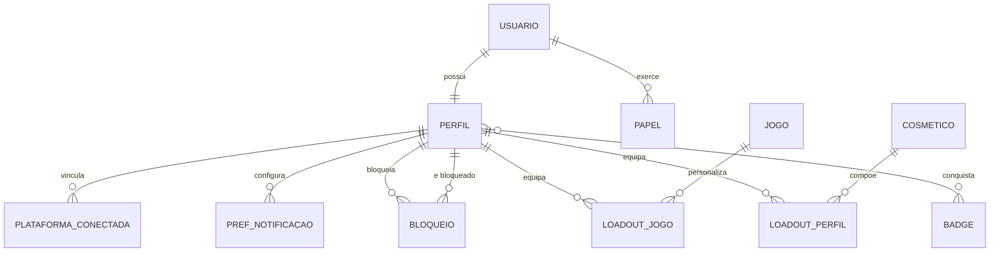
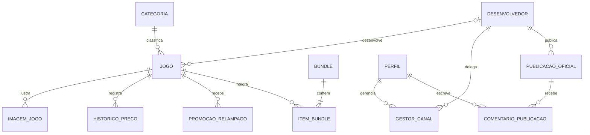
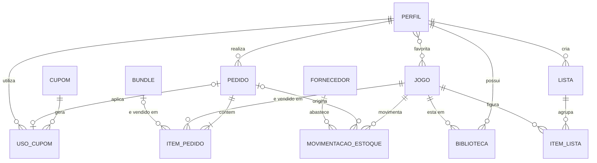
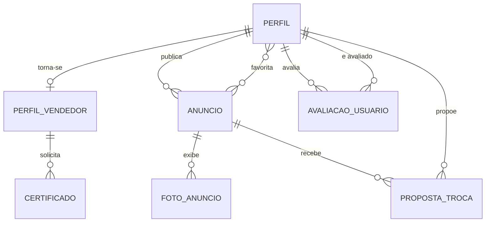
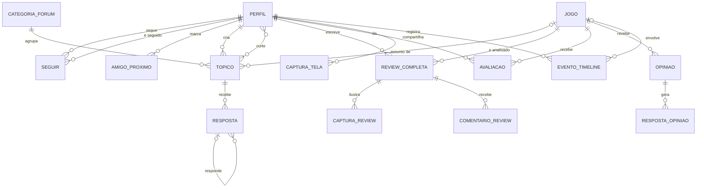
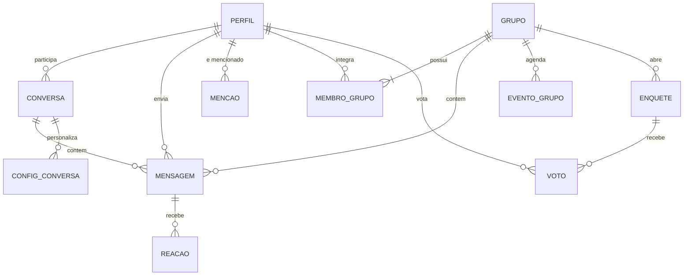
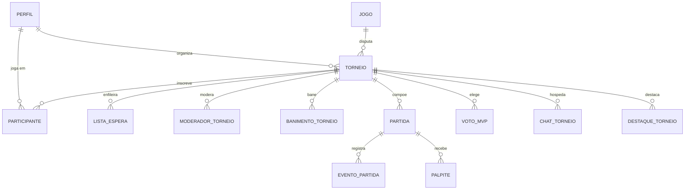
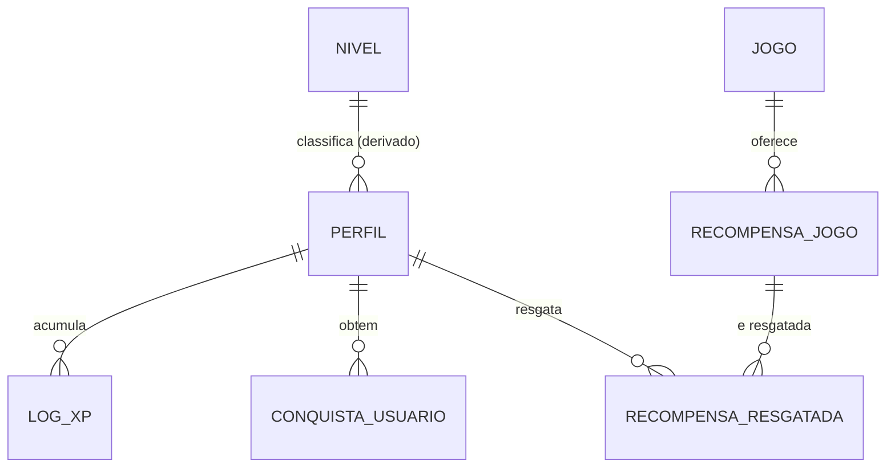
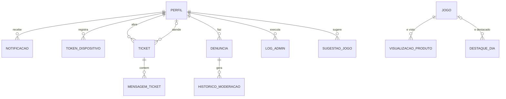
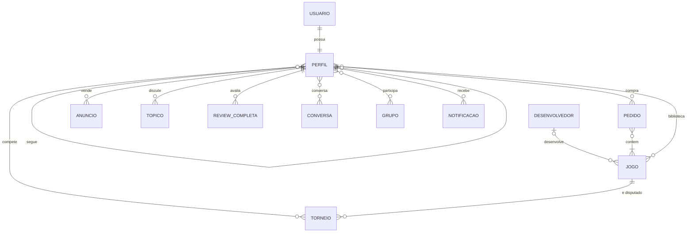

# MER — Modelo Entidade-Relacionamento (Conceitual) · Plataforma MIDIAS

> Modelo conceitual (notação de Peter Chen adaptada) do banco único compartilhado por **Web**, **Mobile (Capacitor)** e **Desktop (Backoffice)**.
> Banco físico: Supabase/PostgreSQL. Este documento descreve **o negócio**, não a implementação (tipos, índices e RLS ficam no DER).

## 0. Convenções

| Símbolo | Significado |
|---|---|
| **Entidade forte** | Existe por si só (ex.: USUÁRIO, JOGO) |
| *Entidade fraca* | Só existe ligada a outra (ex.: ITEM DE PEDIDO) |
| ◇ Entidade associativa | Relacionamento N:N promovido a entidade por ter atributos próprios |
| <u>atributo</u> | Identificador (chave conceitual) |
| {atributo} | Multivalorado |
| /atributo/ | Derivado (calculado) |
| (min,max) | Cardinalidade de participação de cada lado |

Cardinalidade nos diagramas Mermaid: `||` exatamente um · `o|` zero ou um · `}o` zero ou muitos · `}|` um ou muitos.

---

## 1. Identidade, Perfis & Cosméticos

### Entidades
- **USUÁRIO** (conta de autenticação) — <u>id</u>, e-mail, data de criação.
- **PERFIL** — <u>id</u> (= usuário), nome de exibição, @username, avatar, capa, bio, privacidade, banido_até, preferências de push/e-mail, tema pessoal, /nível/ (derivado do XP).
- **PAPEL** — <u>usuário + papel</u>, papel (admin, moderador, funcionário, usuário), cargo.
- **BADGE** (catálogo) — <u>id</u>, nome, ícone, raridade.
- **COSMÉTICO** — <u>id</u>, tipo (moldura, fundo, título, efeito), raridade, preço/condição.
- **PREFERÊNCIA DE NOTIFICAÇÃO** — <u>usuário + tipo de evento</u>, ativo.
- ◇ **BLOQUEIO** — <u>bloqueador + bloqueado</u>, data.
- ◇ **CONCESSÃO DE PRIVACIDADE** — <u>concedente + beneficiário</u>, escopo.
- **PLATAFORMA CONECTADA** — <u>usuário + plataforma</u> (Steam, PSN, Xbox), id externo.

### Relacionamentos
| Relação | Lado A | Lado B | Regra |
|---|---|---|---|
| POSSUI | USUÁRIO (1,1) | PERFIL (1,1) | Todo usuário tem exatamente um perfil |
| EXERCE | USUÁRIO (1,1) | PAPEL (0,N) | Admin do desktop = papel admin |
| CONQUISTA | PERFIL (0,N) | BADGE (0,N) | N:N via USER_BADGES |
| EQUIPA (perfil) | PERFIL (0,N) | COSMÉTICO (0,N) | Loadout do perfil |
| EQUIPA (jogo) | PERFIL + JOGO | COSMÉTICO | Loadout por página de jogo (ternário) |
| BLOQUEIA | PERFIL (0,N) | PERFIL (0,N) | Auto-relacionamento |

---

## 2. Catálogo & Desenvolvedores

### Entidades
- **DESENVOLVEDOR (estúdio)** — <u>id</u>, slug, nome, logo, capa, país, ano de fundação, site, descrição, redes {sociais}.
- **JOGO (produto)** — <u>id</u>, título, descrição, capa, {galeria}, preço, preço promocional, /desconto %/, gênero, {plataformas}, data de lançamento, publicadora, ativo, /nota média/.
- **CATEGORIA** — <u>id</u>, nome, slug.
- **BUNDLE (pacote)** — <u>id</u>, nome, capa, descrição, preço do pacote, /economia/.
- *HISTÓRICO DE PREÇO* — <u>jogo + data</u>, preço.
- **PROMOÇÃO RELÂMPAGO** — <u>id</u>, jogo, % desconto, início, fim.
- ◇ **GESTOR DE CANAL** — <u>desenvolvedor + usuário</u>, concedido por, data.
- **PUBLICAÇÃO OFICIAL** — <u>id</u>, texto, {imagens}, data. *(Somente conta oficial/gestor publica.)*
- *COMENTÁRIO DE PUBLICAÇÃO* — <u>id</u>, texto, autor, data.

### Relacionamentos
| Relação | Lado A | Lado B | Regra |
|---|---|---|---|
| DESENVOLVE | DESENVOLVEDOR (0,N) | JOGO (0,1) | Jogo liga ao estúdio pelo id, nunca pelo nome da publicadora |
| CLASSIFICA | CATEGORIA (0,N) | JOGO (1,1) | |
| COMPÕE ◇ | BUNDLE (1,N) | JOGO (0,N) | Preço do bundle é único, não a soma |
| GERENCIA ◇ | USUÁRIO (0,N) | DESENVOLVEDOR (0,N) | Não concede acesso ao desktop |
| PUBLICA | DESENVOLVEDOR (1,1) | PUBLICAÇÃO (0,N) | |
| COMENTA | PERFIL (0,N) | PUBLICAÇÃO (0,N) | Usuários só comentam |

---

## 3. Comércio B2C, Estoque & Biblioteca

### Entidades
- **PEDIDO** — <u>id</u>, data, status (pendente, pago, cancelado, reembolsado), subtotal, desconto, /total/.
- *ITEM DE PEDIDO* — <u>pedido + nº</u>, quantidade, preço unitário (congelado na compra).
- **CUPOM** — <u>código</u>, tipo (% ou valor), valor, validade, limite de usos, /usos restantes/.
- ◇ **USO DE CUPOM** — <u>cupom + usuário + pedido</u>, data.
- **MOVIMENTAÇÃO DE ESTOQUE** — <u>id</u>, tipo (entrada/saída/ajuste), quantidade, motivo.
- **FORNECEDOR** — <u>id</u>, razão social, contato.
- ◇ **BIBLIOTECA** — <u>usuário + jogo</u>, data de aquisição, status (jogando, zerado, backlog), capa personalizada, /horas jogadas/.
- **LISTA DA BIBLIOTECA / LISTA CURADA** — <u>id</u>, nome, visibilidade, {itens}.
- **FAVORITO (jogo)** — <u>usuário + jogo</u>.

### Regras de negócio
- Pedido e cupom são gravados **atomicamente** (`create_order_secure`); o cliente nunca altera status.
- Compra paga → jogo entra na BIBLIOTECA.

---

## 4. Marketplace C2C & Trocas

### Entidades
- **PERFIL DE VENDEDOR** — <u>usuário</u>, nome da loja, /reputação/, certificado (status).
- **CERTIFICADO** — <u>id</u>, status (pendente, aprovado, recusado), data de envio, data de revisão.
- **ANÚNCIO** — <u>id</u>, título do jogo, {plataformas}, condição, preço, aceita troca, status, data.
- *FOTO DE ANÚNCIO* — <u>anúncio + ordem</u>, URL.
- **PROPOSTA DE TROCA** — <u>id</u>, anúncio alvo, oferta, status (aberta, aceita, recusada).
- ◇ **AVALIAÇÃO DE USUÁRIO** — <u>avaliador + avaliado + transação</u>, nota, comentário.
- ◇ **FAVORITO DE ANÚNCIO** — <u>usuário + anúncio</u>.

---

## 5. Social, Fórum, Reviews & Linha do Tempo

### Entidades
- ◇ **SEGUIR** — <u>seguidor + seguido</u>, data. /Amizade/ = seguir mútuo.
- ◇ **PEDIDO DE SEGUIR** (perfis privados) — status.
- ◇ **AMIGO PRÓXIMO** — <u>dono + amigo</u>.
- **CATEGORIA DO FÓRUM** — <u>id</u>, nome, jogo (opcional).
- **TÓPICO** — <u>id</u>, título, conteúdo, fixado, /nº de respostas/, /curtidas/.
- *RESPOSTA* — <u>id</u>, conteúdo, resposta-pai (aninhamento).
- **REVIEW COMPLETA** — <u>id</u>, nota, análise, prós, contras, horas jogadas, visibilidade.
- *CAPTURA DA REVIEW*, *COMENTÁRIO DA REVIEW*.
- **AVALIAÇÃO (estrelas)** — <u>usuário + jogo</u>, nota 1–5, comentário.
- **OPINIÃO DE JOGO** + *RESPOSTA DE OPINIÃO* + **CONVERSA DE OPINIÃO**.
- **CAPTURA DE TELA / CLIPE** — <u>id</u>, mídia, legenda, jogo.
- **EVENTO DA LINHA DO TEMPO** — <u>id</u>, tipo (comprou, zerou, conquista), data.
- **DESTAQUE DO PERFIL** — <u>id</u>, conteúdo fixado.

### Curtidas (padrão repetido)
Toda curtida é entidade associativa ◇ <u>usuário + conteúdo</u> (tópico, resposta, review, opinião, captura), garantindo **uma curtida por pessoa**.

---

## 6. Mensageria & Grupos

### Entidades
- **CONVERSA (direta)** — <u>id</u>, participante A, participante B, tipo (amigo, vendedor, torneio), /última mensagem/.
- *MENSAGEM* — <u>id</u>, conteúdo, anexo, lida, data.
- ◇ **REAÇÃO** — <u>mensagem + usuário + emoji</u>.
- ◇ **CONFIGURAÇÃO DA CONVERSA** — <u>conversa + usuário</u>, silenciada, fixada, arquivada.
- **MENÇÃO** — <u>id</u>, quem mencionou, mencionado, conteúdo de origem.
- **GRUPO** — <u>id</u>, nome, foto, descrição, privacidade.
- ◇ **MEMBRO DO GRUPO** — <u>grupo + usuário</u>, função (dono, admin, membro).
- **EVENTO DO GRUPO**, **ENQUETE** → ◇ **VOTO** (<u>enquete + usuário</u>).

---

## 7. Torneios & Esports

### Entidades
- **TORNEIO** — <u>id</u>, nome, jogo, formato (eliminatória, grupos), vagas, /vagas restantes/, status, oficial/verificado, visibilidade, datas.
- ◇ **PARTICIPANTE** — <u>torneio + usuário</u>, seed, confirmado, posição final.
- ◇ **LISTA DE ESPERA**, ◇ **BANIMENTO**, ◇ **MODERADOR** — <u>torneio + usuário</u>.
- *PARTIDA* — <u>torneio + rodada + nº</u>, jogador A, jogador B, placar, vencedor.
- *EVENTO DE PARTIDA* — gol, kill, pausa etc.
- **CHAT DO TORNEIO** + ◇ silenciamento.
- ◇ **PALPITE** — <u>partida + usuário</u>, vencedor previsto. ◇ **VOTO MVP** — <u>torneio + usuário</u>.
- **HISTÓRIA / DESTAQUE / ALERTA DE DUPLICIDADE / LEMBRETE**.

---

## 8. Gamificação

- **NÍVEL** — <u>nível</u>, XP mínimo, título.
- *LOG DE XP* — <u>id</u>, usuário, quantidade, motivo, data. *(Concedido apenas por funções confiáveis/admin.)*
- ◇ **CONQUISTA DO USUÁRIO** — <u>usuário + conquista</u>, data.
- **RECOMPENSA DE JOGO** → ◇ **RECOMPENSA RESGATADA** (<u>usuário + recompensa</u>).

---

## 9. Backoffice, Suporte & Governança

- **MEMBRO DA EQUIPE MIDIAS** — <u>id</u>, slug, nome, cargo, bio, foto, capa, {redes}, ordem, ativo. *(Independente das contas de usuário.)*
- **NOTIFICAÇÃO** — <u>id</u>, destinatário, tipo, título, link, lida.
- **TOKEN DE DISPOSITIVO** — <u>token</u>, usuário, plataforma.
- **TICKET** → *MENSAGEM DE TICKET*; status, prioridade, atendente.
- **DENÚNCIA** — <u>id</u>, denunciante, alvo (polimórfico: usuário, anúncio, post…), motivo, status.
- **HISTÓRICO DE MODERAÇÃO**, **LOG ADMINISTRATIVO** — quem fez, ação, entidade, data.
- **SUGESTÃO DE JOGO**, **CONFIGURAÇÕES DO SITE** (FAQ, termos), **WEBHOOK**, **DESTAQUE DO DIA**, **VISUALIZAÇÃO DE PRODUTO**.

---

## 10. Visão geral (entidades centrais)

## 11. Restrições de integridade de negócio

1. Um perfil por usuário; @username único.
2. Curtidas, favoritos, votos e palpites: **um por pessoa por item**.
3. Ninguém segue, bloqueia ou conversa consigo mesmo.
4. Usuário bloqueado não envia mensagem nem vê conteúdo de quem o bloqueou.
5. Preço do item do pedido é congelado no momento da compra.
6. Cupom: usado dentro da validade e do limite, uma vez por usuário, junto com o pedido.
7. Só a conta oficial/gestor publica no canal do desenvolvedor; demais apenas comentam.
8. Torneio não aceita participantes além das vagas (excedente vai para a lista de espera).
9. Status de pedido e XP só mudam por funções confiáveis ou pela equipe.
10. Usuário com `banido_até` no futuro não interage.
